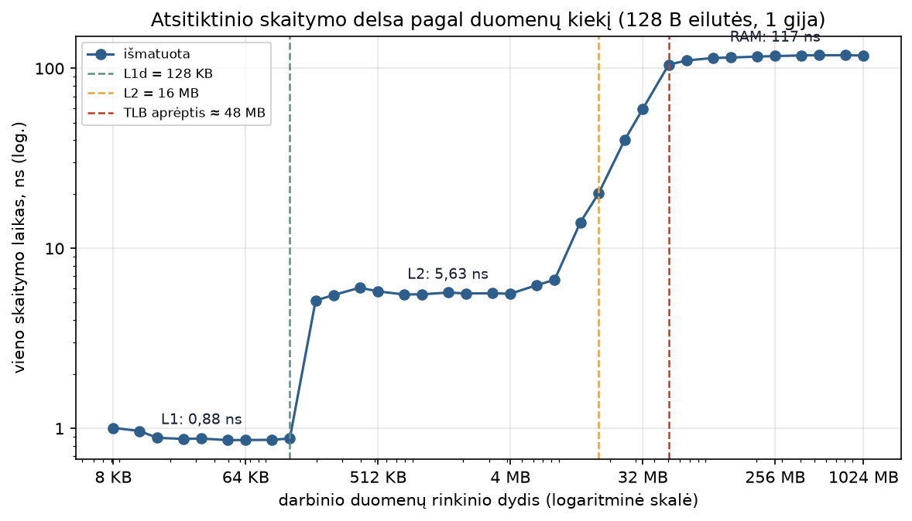
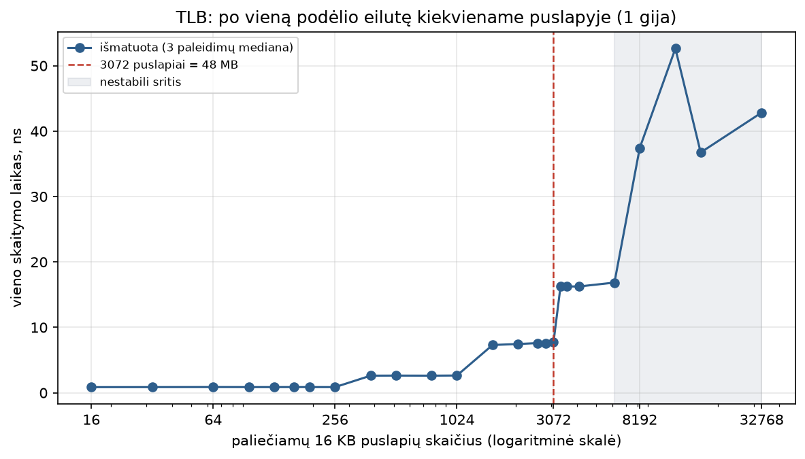
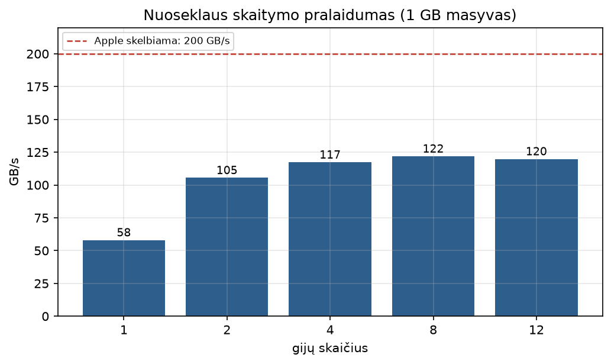

# Atminties hierarchijos matavimai

Kompiuterio parametrai: [machine.md](machine.md). Programa:
[`src/tools/memlat.cpp`](../src/tools/memlat.cpp), paleidimas `make memory`
([`scripts/memory.sh`](../scripts/memory.sh)); duomenys – `results/memory/*.csv`, grafikai –
[`img/memory/`](img/memory/) ([`scripts/plot_memory.py`](../scripts/plot_memory.py)).

Tikslas – išmatuoti, kiek kainuoja duomenų atnešimas iš kiekvieno atminties hierarchijos
lygio šiame kompiuteryje, ir patikrinti skaičius, kuriais remiasi kitų dokumentų analizė
(TLB riba [tlb_cliff.md](tlb_cliff.md), `openmp-opt` plečiamumas
[openmp_opt2.md](openmp_opt2.md)).

## 1. Metodika

**Delsa (`memlat lat`).** Rodyklių sekimas (pointer chasing): buferyje kiekviena 128 B
podėlio eilutė saugo kitos eilutės adresą, o eilučių tvarka – vienas atsitiktinis ciklas
(Sattolo algoritmas). Kiekvienas skaitymas priklauso nuo ankstesnio, o kitas adresas
atsitiktinis, todėl nei procesorius, nei išankstinis įkėlimas (prefetcher) negali jo
nuspėti: vieno žingsnio laikas lygus to lygio, iš kurio ateina duomenys, delsai.
Buferio dydis – nuo 8 KB iki 1 GB. Kiekvienas taškas – geriausias iš 3 matavimų po
≥ 8 mln. skaitymų, prieš tai ciklas „sušildomas“.

**TLB (`memlat tlb`).** Tas pats rodyklių sekimas, bet kiekviename 16 KB puslapyje – tik
viena eilutė (eilutės vieta puslapyje keičiasi, kad eilutės pasiskirstytų po visas
podėlio aibes). Keičiamas paliečiamų puslapių skaičius: 16–32768. Eilučių iš viso mažai
(32768 × 128 B = 4 MB telpa L2), todėl laiko šuolis rodo TLB, o ne podėlio ribą.
Matuojama 3 kartus, grafike – mediana.

**Pralaidumas (`memlat bw`).** 1 GB masyvo nuoseklus skaitymas (sumavimas), padalytas
1, 2, 4, 8 ir 12 gijų. Kiekvienas taškas – geriausias iš 5 paleidimų; visas matavimas
kartojamas 3 kartus, grafike – didžiausia reikšmė (gijų išdėstymas po branduolius tarp
paleidimų skiriasi).

Viena gija veikia našiajame (P) branduolyje (macOS taip planuoja priekinio plano
procesus).

## 2. Delsa pagal duomenų kiekį



| darbinis rinkinys | delsa | lygis |
|-------------------|-------|-------|
| 8 KB – 128 KB | **0,88 ns** (≈ 3 taktai) | L1 (128 KB) |
| 192 KB – 8 MB | **5,6 ns** (≈ 20 taktų) | L2 (16 MB) |
| 12 MB – 32 MB | 14 → 60 ns | pereinamoji sritis: L2 + SLC + operatyvioji atmintis |
| ≥ 48 MB | **105 → 118 ns** (≈ 400 taktų) | operatyvioji atmintis (+ TLB praleidimai) |

- L1 riba matoma tiksliai ties 128 KB, kaip nurodo `sysctl`.
- L2 delsa pradeda augti jau nuo ≈ 8 MB, nors L2 – 16 MB: jį dalijasi 4 branduoliai, o
  pakeitimo politika nėra tobula, todėl atsitiktinė prieiga išnaudoja ne visą talpą.
- Aiškios SLC pakopos nėra: 12–32 MB srityje dalis skaitymų patenka į SLC, dalis – į
  operatyviąją atmintį.
- Daugiau nei 48 MB atsitiktinė prieiga dar ir viršija TLB aprėptį, todėl ≈ 117 ns apima
  ir puslapių lentelės peržiūrą.

Operatyvioji atmintis yra **≈ 130 kartų lėtesnė už L1** – tai ir yra „atminties siena“.

## 3. TLB



| puslapių | aprėptis | delsa | kas vyksta |
|----------|----------|-------|------------|
| 16 – 256 | iki 4 MB | 0,87 ns | eilutės L1, vertimai L1 duomenų TLB |
| 384 – 1024 | 6 – 16 MB | **2,6 ns** | L1 TLB praleidimas, vertimas randamas L2 TLB (+1,75 ns) |
| 1536 – 3072 | 24 – 48 MB | 7,3 – 7,7 ns | eilučių (≥ 192 KB) nebetelpa L1 → jos L2 podėlyje; vertimai L2 TLB |
| **3328 – 6144** | 52 – 96 MB | **16,3 ns** | **L2 TLB praleidimas → puslapių lentelės peržiūra** (+8,6 ns) |
| ≥ 8192 | ≥ 128 MB | 17 – 53 ns, nestabilu | puslapių lentelės įrašai patys nebetelpa podėlyje |

Išvados:

- **L2 TLB turi ≈ 3072 įrašus:** šuolis tarp 3072 ir 3328 puslapių kartojasi kiekviename
  paleidime. Tai patvirtina skaičių, kuriuo remiasi TLB ribos modelis
  ([tlb_cliff.md](tlb_cliff.md)): 4·n² / 16384 > 3072 ⇒ **n > 3547**.
- L1 duomenų TLB – tarp 256 ir 384 įrašų.
- TLB praleidimas kainuoja daugiau nei L2 podėlio skaitymas: +8,6 ns prieš 5,6 ns.
- Pastaba: su vos 8 puslapiais (8 skaitymų ciklas) gauta 0,3 ns – mažiau už L1 delsą;
  procesorius tokį trumpą ciklą „nuspėja“, todėl matavimas pradedamas nuo 16 puslapių.

## 4. Pralaidumas



| gijų | 1 | 2 | 4 | 8 | 12 |
|------|---|---|---|---|----|
| GB/s | **58** | 105 | 117 | **122** | 120 |

- Viena gija pasiekia 58 GB/s; nuo 4 gijų pralaidumas beveik nebeauga (≈ 120 GB/s).
- CPU nepasiekia Apple skelbiamų 200 GB/s: tai viso lusto (CPU + GPU) pralaidumas.
- Todėl programa, kuri kiekvienam skaičiavimui skaito naujus duomenis iš atminties,
  su 8 gijomis gali paspartėti tik ≈ 2 kartus, ne 8.

## 5. Ką tai paaiškina matricų daugyboje

**`seq-base` ir TLB riba.** i-j-z cikle B skaitoma stulpeliu, kiekvienas žingsnis – kitas
puslapis. Kol B telpa TLB aprėptyje (n ≤ 3547), vertimai randami L2 TLB. Nuo n ≈ 3550 vienos
operacijos kaina pakyla nuo 1,1 iki 3,2 ns (n = 3500 → 4000). Tai mažiau nei visa
puslapių lentelės peržiūra (+8,6 ns), nes stulpelio skaitymai nepriklausomi ir procesorius
vykdo kelis praleidimus vienu metu.

**`openmp-opt` (i-k-j) ir pralaidumas.** Kiekvienai A eilutei skaitoma visa matrica B
(64 MB), kai n = 4000 – iš viso iki 4·n³ = 256 GB.
- Viena gija: daugyba trunka 4,73 s → **54 GB/s**, t. y. 93 % išmatuoto vienos gijos
  pralaidumo. Vienos gijos `openmp-opt` riboja atminties pralaidumas, ne skaičiavimas.
- 8 gijos: 1,05 s. Jei visa B būtų skaitoma iš atminties, reikėtų 245 GB/s – du kartus
  daugiau, nei įmanoma (122 GB/s). Vadinasi, gijos dalijasi B eilutėmis per bendrą L2
  (4 gijos vienoje grupėje), bet vis tiek atsiremia į pralaidumą: pagreitėjimas tik
  4,4×.

**`seq-opt`, `openmp-opt2` (blokavimas).** B blokas laikomas L2 ir panaudojamas daug kartų,
todėl operatyviosios atminties srautas sumažėja dešimtis kartų, o TLB praleidimų beveik
nebėra (supakuotas blokas – ištisinis). Vienos operacijos kaina pastovi nuo n = 2000 iki
16000 ([seq_opt.md](seq_opt.md), [openmp_opt2.md](openmp_opt2.md)).

## 6. Pakartojimas

```sh
make memory    # ≈ 3 min.; kompiuteris turi būti neapkrautas
```

Rezultatai iš pradžių rašomi į laikiną failą už projekto ribų ir tik tada perkeliami:
projektas yra OneDrive aplanke, o OneDrive praranda dalį eilučių, kai programa ilgai
rašo į atidarytą failą (pastebėta: 13 iš 26 eilučių, nors programa baigėsi sėkmingai).
