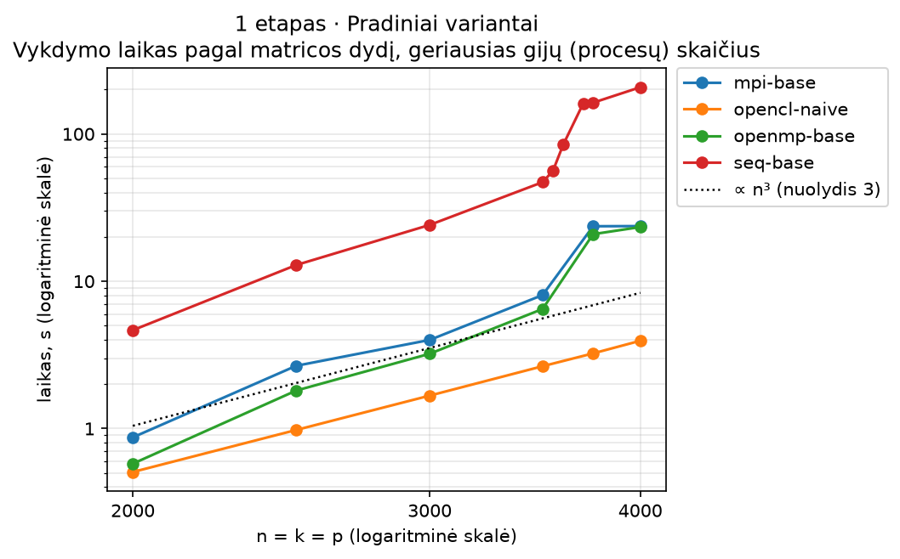

# 1 etapas · Bazinės realizacijos

Duomenys: `seq-base`, `openmp-base`, `mpi-base`, `opencl-base` (kernelis `naive`),
n = k = p = 2000…4000.

Visi baziniai variantai daugina vadovėline ciklų tvarka i-j-z: kiekvienam C elementui
A eilutė dauginama iš B **stulpelio**. `openmp-base` ir `mpi-base`
paskirsto C eilutes gijoms / procesams; `opencl-naive` kiekvienam GPU darbo elementui (work-item)
skiria po vieną C elementą.

`total` laikas, geriausias gijų (procesų) skaičius:

| n    | seq-base | openmp-base | mpi-base | opencl-naive |
|------|----------|-------------|----------|--------------|
| 2000 | 4,65 s   | 0,58 s      | 0,87 s   | 0,51 s       |
| 4000 | 208 s    | 23,3 s      | 23,7 s   | 3,95 s       |

Pastebėjimai:

- Lygiagretūs CPU variantai su 12 gijų (procesų) yra maždaug 9× greitesni už `seq-base`;
  OpenMP ir MPI elgiasi beveik vienodai (tas pats ciklas, tas pats eilučių paskirstymas).
- **Visų CPU variantų laikas tarp n = 3500 ir 3750 šokteli maždaug 3×.** Padvigubinus n, laikas turėtų
  išaugti 8× (n³), bet 2000 → 4000 kainuoja 45×. Tai nepriklauso nuo gijų (procesų)
  skaičiaus (žr. `openmp-base-time.png`, `mpi-base-time.png`). → [2 etapas](../02-tlb-cliff/README.md)
- GPU tokio šuolio neturi, bet toli gražu neišnaudoja savo galimybių. → [6 etapas](../06-opencl/README.md)

Kiti grafikai: `<variant>-speedup.png` (kiekvieno varianto plečiamumas, lyginant su jo paties laiku su 1 gija (procesu)),
`size-linear.png` (laikas pagal operacijų skaičių n·k·p, tiesinės ašys).
