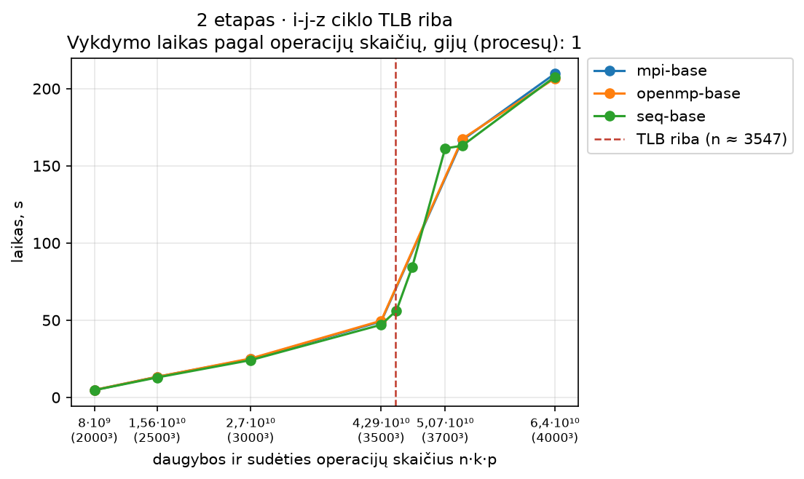

# 2 etapas · Staigus i-j-z ciklo sulėtėjimas ties TLB riba

Duomenys: `seq-base`, `openmp-base`, `mpi-base`, **1 gija (procesas)**, n = 2000…4000
(`seq-base` taip pat su 3550, 3600, 3700, kad būtų tiksliau nustatyta riba).

Ašis X – daugybos ir sudėties operacijų skaičius n·k·p (= n³). Kol vienos operacijos
kaina nepriklauso nuo n, taškai guli tiesėje; ties TLB riba tiesė lūžta ir tampa
kelis kartus statesnė.

Laikas vienai daugybos ir sudėties operacijai, 1 gija (procesas):

| n           | 2000 | 3000 | 3500 | 3550 | 3600 | 3700 | 4000 |
|-------------|------|------|------|------|------|------|------|
| seq-base, ns | 0,58 | 0,89 | 1,10 | 1,26 | 1,81 | 3,18 | 3,24 |

Visi trys variantai yra vienoje kreivėje: su viena gija (procesu) jie vykdo tą patį ciklą, todėl
efektą lemia atminties prieigos šablonas, o ne lygiagretumas.

**Priežastis.** Vidinis ciklas `z` skaito B stulpeliu: gretimus elementus skiria p·4 baitų,
todėl kiekvienas kreipinys patenka į kitą 16 KB puslapį. Vienas stulpelio perėjimas paliečia
k·p·4 / 16384 puslapių; kai jų daugiau nei ~3072 L2 TLB (adresų vertimo buferio) įrašų, kiekvienam kreipiniui
reikia peržiūrėti puslapių lentelę (page-table walk). 4·n² / 16384 = 3072 duoda **n ≈ 3547** (raudona linija).
Perėjimas laipsniškas (3550 → 3700) dėl kitų podėlio /
TLB hierarchijos lygių. Išsamiau ir jį patvirtinantis eksperimentas (n = 200, keičiant k = p):
[`docs/tlb_cliff.md`](../../docs/tlb_cliff.md).

L2 TLB dydį (≈ 3072 įrašai) patvirtina tiesioginis matavimas: kai paliečiama daugiau nei
3072 puslapių, vieno skaitymo laikas šokteli nuo 7,7 iki 16,3 ns
([`docs/memory.md`](../../docs/memory.md), 3 skyrius).

**Pasekmės.**

- Pagreitėjimai `seq-base` atžvilgiu, kai n viršija ≈ 3500, yra išpūsti dėl atminties efekto.
  Todėl kiekviename pagreitėjimo grafike variantas lyginamas su *pačiu savimi*, vykdomu su 1 gija (procesu).
- Sprendimas – nebeskaityti B stulpeliu: pakeisti ciklų tvarką ir taikyti
  blokavimą (skaidymą blokais). → [3 etapas](../03-seq-opt/README.md)
