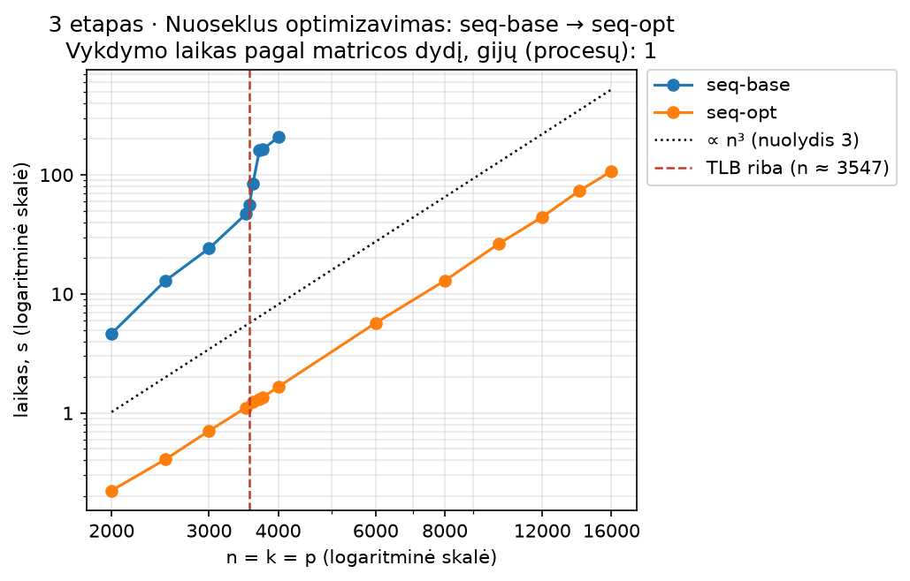

# 3 etapas · Nuoseklaus kodo optimizavimas: seq-base → seq-opt

Duomenys: `seq-base` (2000…4000), `seq-opt` (2000…16000), 1 branduolys.

`seq-opt` ([`docs/seq_opt.md`](../../docs/seq_opt.md)) išlaiko užduoties semantiką ir
nenaudoja gijų. Skaičiavimo branduolys ([`include/gemm.hpp`](../../include/gemm.hpp)) parašytas
GotoBLAS stiliumi:

- A, B ir C **blokavimas** (skaidymas blokais), kad darbinis duomenų rinkinys (working set) tilptų podėliuose;
- B bloko **pakavimas** į ištisinį buferį: B skaitoma eilutėmis, 2 etapo
  TLB problema išnyksta;
- **4 × 16 mikrobranduolys su blokavimu registruose**: 64 akumuliatoriai NEON registruose, kiekviena įkelta
  reikšmė panaudojama 4 arba 16 kartų.

| n     | seq-base | seq-opt | kiek kartų greičiau |
|-------|----------|---------|-----------|
| 2000  | 4,65 s   | 0,224 s | 21×       |
| 4000  | 208 s    | 1,66 s  | 125×      |
| 16000 | –        | 107 s   |           |

`seq-opt` nuo 2000 iki 16000 vienai daugybos ir sudėties operacijai sugaišta pastovias **0,025 ns** (apie 40·10⁹ operacijų per sekundę
viename branduolyje): ties 3547 jokio staigaus sulėtėjimo. Iš 125× ties n = 4000 maždaug 21× duoda
geresnis skaičiavimo branduolys, o likusius 6× – išvengtas staigus sulėtėjimas ties TLB riba.

Tą patį skaičiavimo branduolį pakartotinai naudoja `openmp-opt2` ir `mpi-opt`. → [4 etapas](../04-openmp/README.md)
