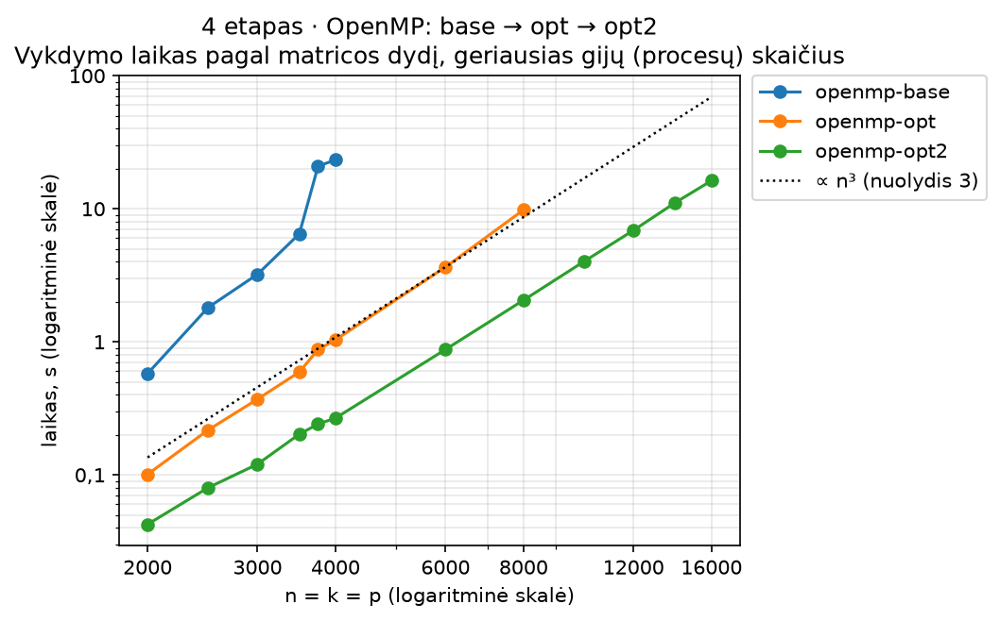
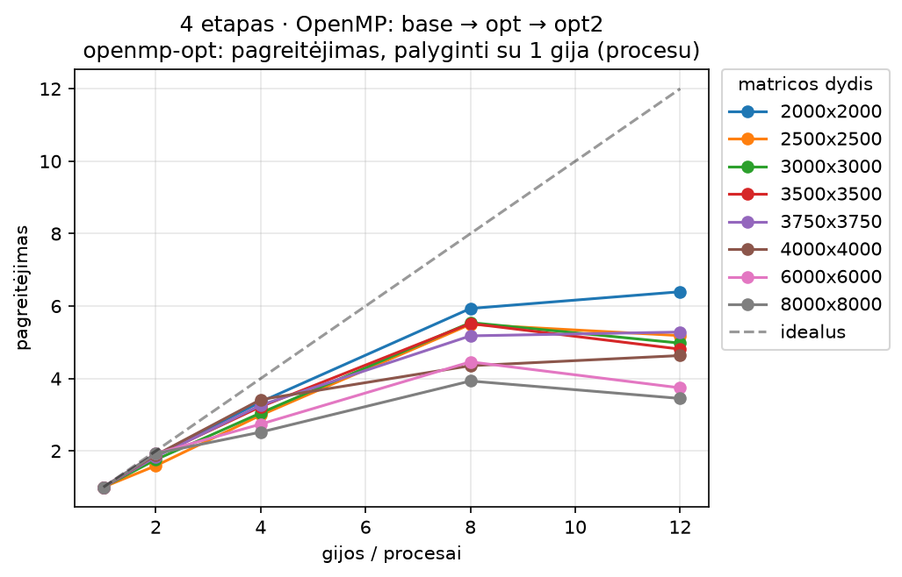
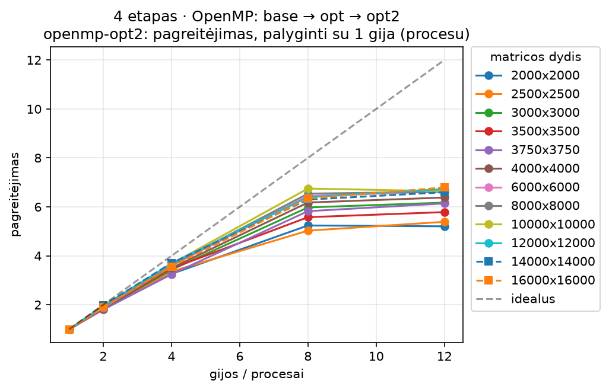

# 4 etapas · OpenMP: base → opt → opt2

Duomenys: `openmp-base` (n ≤ 4000), `openmp-opt` (n ≤ 8000), `openmp-opt2`
(n ≤ 16000), 1…12 gijų. Kiekvienas variantas parodytas iki dydžio, ties kuriuo jį nustojome
tobulinti; toliau yra tik pavieniai paleidimai, ir jie nieko neprideda.

| variantas | daugyba |
|---------|----------------|
| `openmp-base` | i-j-z, `parallel for` per C eilutes |
| `openmp-opt`  | i-k-j tvarka (B skaitoma eilutėmis) + `simd`, `schedule(static)` |
| `openmp-opt2` | blokavimas + pakavimas + 4 × 16 mikrobranduolys, `schedule(dynamic, 1)` ([`docs/openmp_opt2.md`](../../docs/openmp_opt2.md)) |

`total` laikas:

| n     | gijos | openmp-base | openmp-opt | openmp-opt2 |
|-------|---------|-------------|------------|-------------|
| 4000  | 1       | 207 s       | 4,80 s     | 1,71 s      |
| 4000  | 8       | 28,7 s      | 1,10 s     | 0,276 s     |
| 8000  | 8       | –           | 9,81 s     | 2,08 s      |
| 16000 | 12      | –           | –          | 16,3 s      |

## openmp-base → openmp-opt

`openmp-base` atsitrenkia į TLB ribą ([2 etapas](../02-tlb-cliff/README.md)), ir ties
n = 4000 jo atsisakyta: ten jis 125× lėtesnis už `seq-opt` su vienu branduoliu. Geras jo
plečiamumas (8,9× su 12 gijų, kai n = 4000, `openmp-base-speedup.png`) nepadeda:
greičiausiai jis gerai plečiasi *būtent todėl*, kad kiekviena gija didžiąją laiko dalį laukia atminties, todėl net
taupieji branduoliai padidina bendrą našumą (throughput).

`openmp-opt` pakeičia ciklų tvarką į i-k-j, todėl B skaitoma eilutėmis: ties n = 4000 su viena gija
43× greičiau nei base, ir jokio staigaus sulėtėjimo.

## openmp-opt → openmp-opt2

`openmp-opt` su viena gija pastoviai sugaišta 0,075 ns vienai daugybos ir sudėties operacijai, bet jo
**lygiagretus plečiamumas blogėja didėjant n**:

| n    | pagreitėjimas, 8 gijos | pagreitėjimas, 12 gijų |
|------|--------------------|---------------------|
| 2000 | 5,9×               | 6,4×                |
| 4000 | 4,4×               | 4,6×                |
| 6000 | 4,5×               | 3,7×                |
| 8000 | 3,9×               | 3,5×                |

Kritimas buvo matyti jau ties n = 4000 – būtent tada pradėta ieškoti geresnio
skaičiavimo branduolio; paleidimai su 6000 ir 8000 tai patvirtina. Priežastys
([`docs/openmp_opt2.md`](../../docs/openmp_opt2.md)): kiekviena eilutė srautu perskaito visą B
iš RAM, ir gijos prisotina atminties magistralę; trys atminties operacijos vienai
daugybos ir sudėties operacijai; `schedule(static)` lėtiesiems taupiesiems branduoliams skiria tiek pat eilučių, kiek
greitiesiems, todėl nuo n = 6000 12 gijų yra lėtesnės nei 8.

`openmp-opt2` laiko B blokus (tiles) podėlyje, kaupia sumas registruose ir eilučių blokus
skirsto dinamiškai. Jo laikas vienai daugybos ir sudėties operacijai išlieka pastovus iki n = 16000
(0,0034–0,0040 ns su geriausiu gijų skaičiumi), o plečiamumas didėjant n **gerėja**:

| n     | pagreitėjimas, 8 gijos | pagreitėjimas, 12 gijų |
|-------|--------------------|---------------------|
| 2000  | 5,2×               | 5,2×                |
| 4000  | 6,2×               | 6,4×                |
| 8000  | 6,5×               | 6,6×                |
| 16000 | 6,3×               | 6,8×                |

- 12 gijų dabar niekada nėra lėtesnės nei 8: dinaminis paskirstymas (schedule(dynamic)) leidžia
  taupiesiems branduoliams paimti mažiau blokų.
- Mažesnis pagreitėjimas esant mažam n – tai Amdalo dėsnis: nuoseklusis B pildymas sudaro 31 %
  8 gijų laiko, kai n = 2000, ir 19 %, kai n = 4000.
- Maždaug 6,5× lubos esant dideliam n **nėra** Amdalo dėsnio pasekmė: kai n = 16000,
  nuoseklioji dalis mažesnė nei 1 %, ir dėsnis leidžia 7,5× su 8 gijomis. Likusi dalis – aparatinės
  įrangos nuostoliai, kurie nemažėja didėjant n. → [7 etapas](../07-amdahl/README.md)

Kiti grafikai: `openmp-*-time.png` (laiko priklausomybė nuo gijų skaičiaus, po vieną liniją kiekvienam dydžiui),
`size.png` (laikas pagal n, abi ašys logaritminės) / `size-linear.png` (laikas pagal
operacijų skaičių n·k·p), geriausias gijų skaičius.
