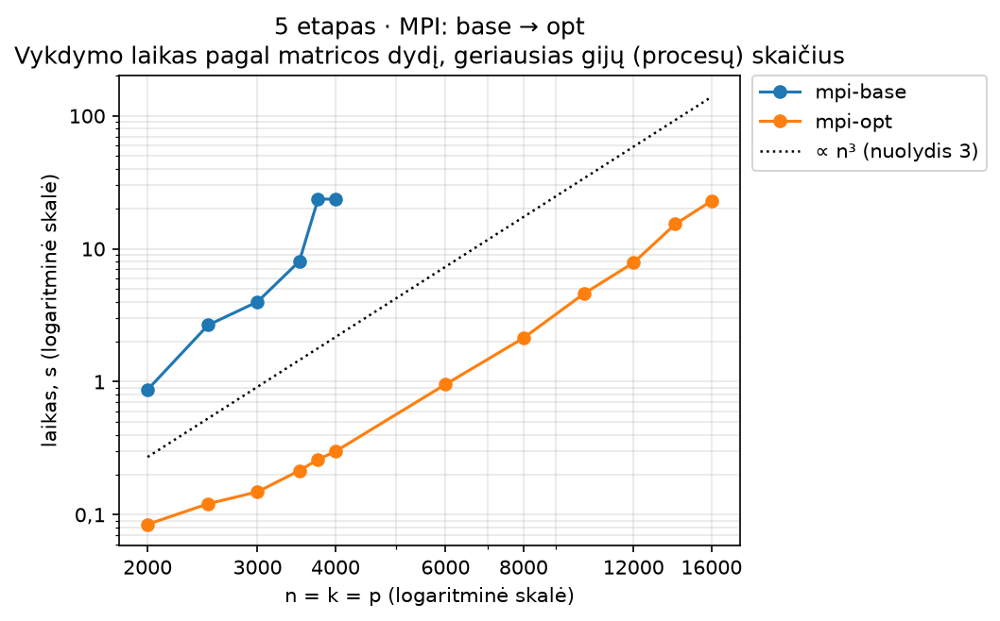
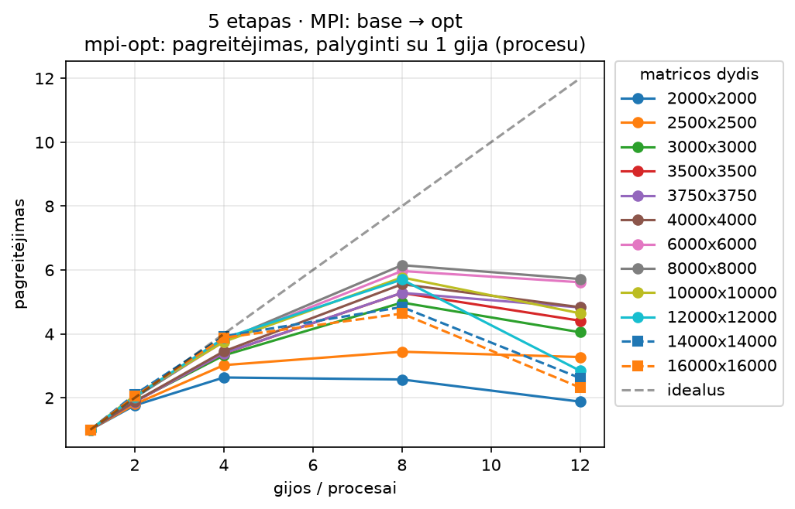

# 5 etapas · MPI: base → opt

Duomenys: `mpi-base` (n ≤ 4000; čia jo, kaip ir `openmp-base`, atsisakyta), `mpi-opt`
(n ≤ 16000), 1…12 procesų.

- `mpi-base` – dėstytojo šablonas („MPI program sample“), ištaisytas ir pritaikytas platformai:
  eilutės paskirstomos cikliškai, ciklas i-j-z, C eilutės siunčiamos rangui 0 per `MPI_Send` /
  `MPI_Recv`; matrix1 pildoma lygiagrečiai, matrix2 – rango 0 procese ir transliuojama `MPI_Bcast`.
- `mpi-opt` – skaičiavimo branduolys iš `gemm.hpp`, ištisiniai eilučių blokai, vienas `MPI_Gatherv`
  su `MPI_IN_PLACE`; pasirinktinis `MPI_Ibcast` konvejeris (numatytuoju atveju išjungtas).

Išsamiau: [`docs/mpi_opt.md`](../../docs/mpi_opt.md).

`total` laikas, n = 4000:

| procesų | mpi-base | mpi-opt | kiek kartų greičiau |
|---------|----------|---------|---------------------|
| 1       | 210 s    | 1,66 s  | 126×                |
| 8       | 29,3 s   | 0,300 s | 98×                 |
| 12      | 23,7 s   | 0,344 s | 69×                 |

- Pagrindinį laimėjimą, kaip ir 4 etape, duoda skaičiavimo branduolys; mažesnis pranešimų skaičius
  (vienas `Gatherv` vietoj n `Send`/`Recv`) svarbus tik tada, kai skaičiavimas jau greitas.
- `mpi-opt` su 8 procesais pasiekia 5,5×, kai n = 4000, o **12 procesų lėtesni nei 8** (4,8×):
  eilutės padalijamos po lygiai, 4 iš 12 procesų veikia taupiuosiuose (E) branduoliuose, ir visi
  laukia jų ties `MPI_Gatherv`. Apkrovos balansavimas sąmoningai nepridėtas, kad būtų matyti
  nevienodų branduolių įtaka (`openmp-opt2` ją apeina dinaminiu paskirstymu).
- `MPI_Ibcast` konvejeris vienoje mašinoje nepadėjo: Open MPI neturi asinchroninės pažangos per
  bendrai naudojamą atmintį, o transliavimas sudaro tik ≈ 6 % daugybos laiko.
- **Dideliems dydžiams plečiamumas krenta:** su 8 procesais 6,2× (n = 8000), 5,7× (12000),
  4,8× (14000) ir 4,6× (16000); su 12 procesų – vos 2,3× (16000). Greičiausiai tai atminties
  stygius: kiekvienas procesas laiko visą B kopiją (n = 16000 – po 1 GB), 12 procesų – ≈ 12 GB
  iš 16 GB. Toliau netirta ([`docs/amdahl.md`](../../docs/amdahl.md), 3 skyrius).

Kiti grafikai: `mpi-base-speedup.png`, `mpi-*-time.png` (laikas pagal procesų skaičių, po liniją
kiekvienam dydžiui), `size.png` (laikas pagal n, abi ašys logaritminės) / `size-linear.png`
(laikas pagal operacijų skaičių n·k·p).
