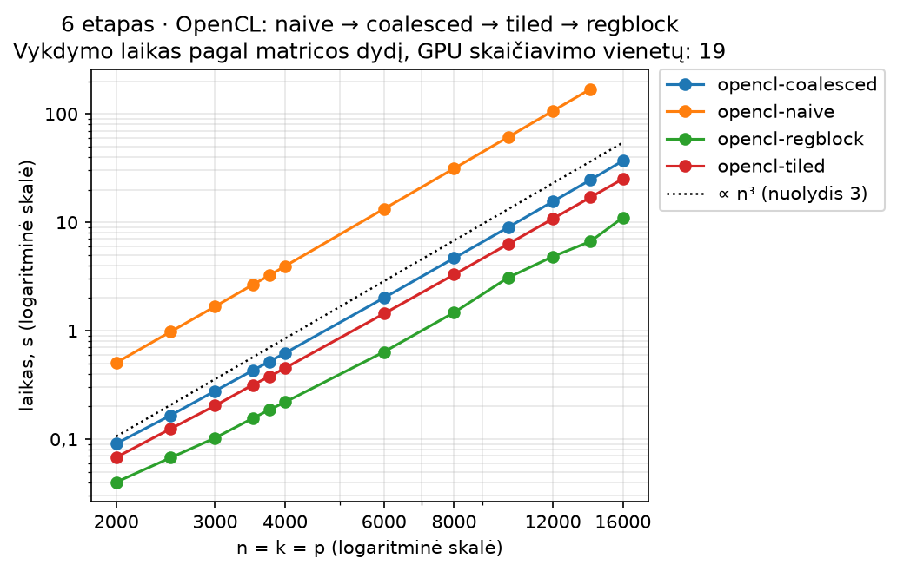

# 6 etapas · OpenCL: naive → coalesced → tiled → regblock

Duomenys: `opencl-base` (branduolys (kernel) `naive`) ir `opencl-opt` (branduoliai `coalesced`,
`tiled`, `regblock`), GPU su 19 skaičiavimo vienetų (compute units).

Išsamiau: [`docs/opencl_opt.md`](../../docs/opencl_opt.md).

`mul` laikas (darbas GPU + sinchronizacija):

| n     | naive  | coalesced | tiled  | regblock | regblock lyginant su naive |
|-------|--------|-----------|--------|----------|-------------------|
| 2000  | 0,483 s | 0,070 s  | 0,048 s | 0,020 s | 24× |
| 4000  | 3,87 s  | 0,545 s  | 0,375 s | 0,143 s | 27× |
| 8000  | 31,0 s  | 4,39 s   | 3,01 s  | 1,19 s  | 26× |
| 14000 | 168 s   | 23,7 s   | 16,1 s  | 5,77 s  | 29× |

Kiekvienas žingsnis pašalina vieną siaurąją vietą (bottleneck), o laikas vienai operacijai didėjant n išlieka pastovus:

1. **coalesced** (7×): stulpelio indeksas perkeliamas į NDRange 0 dimensiją, todėl gretimi
   darbo elementai (work-items) skaito gretimus B adresus viena transakcija (sujungti kreipiniai); `mad24`.
2. **tiled** (1,45×): 16 × 16 A ir B blokai lokaliojoje atmintyje, kiekvienas įkeltas elementas
   panaudojamas 16 kartų.
3. **regblock** (2,6×): kiekvienas darbo elementas registruose apskaičiuoja 8 × 8 C elementus;
   apie 450·10⁹ daugybos ir sudėties operacijų per sekundę.

Pagrindinė programa (host) taip pat buvo sustiprinta: buferiai be kopijavimo (zero-copy), paleidimai eilučių juostomis, kiekvieno
branduolio būsenos patikra ir atrankinė rezultato patikra. Vienas `naive` paleidimas su n = 14000 kartą
„baigėsi“ per 0,22 s – greičiau, nei leidžia didžiausias GPU našumas: branduolys buvo nutrauktas, o
rezultatas taip ir nepatikrintas. Tokie paleidimai dabar žymimi `FAILED` ir neišsaugomi.

Kas lieka: CPU atliekamas matricos B pildymas dabar sudaro 27 % viso laiko, kai n = 4000. → [7 etapas](../07-amdahl/README.md)
