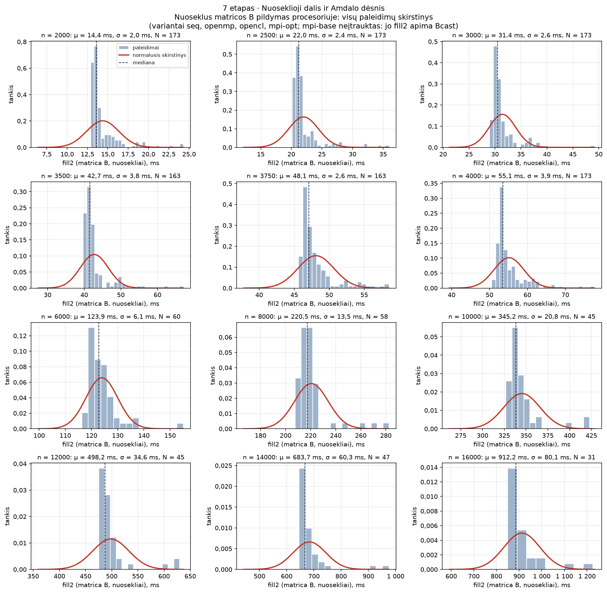
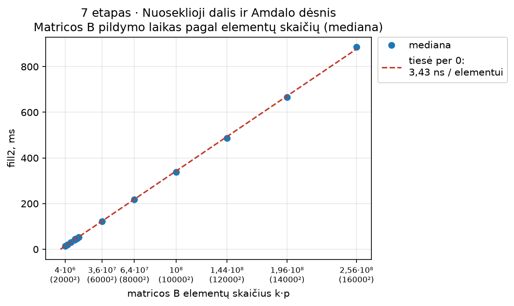
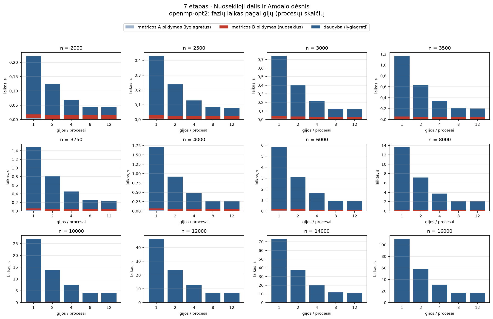
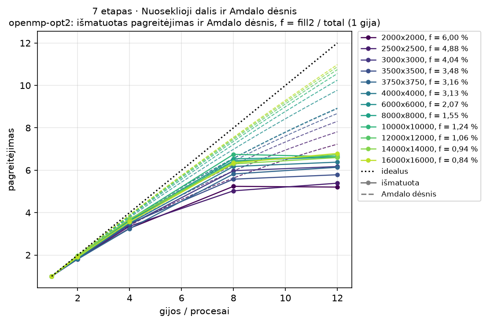
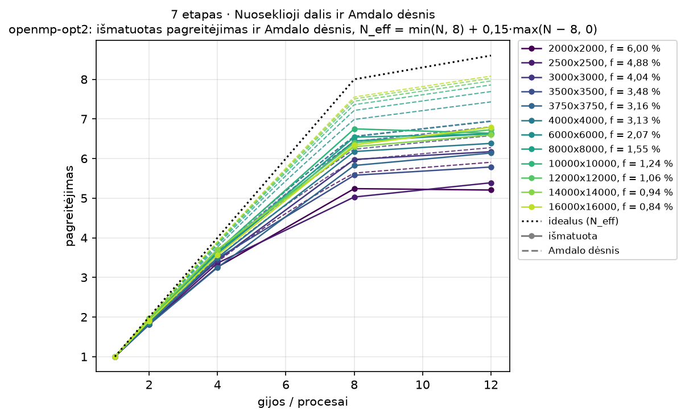
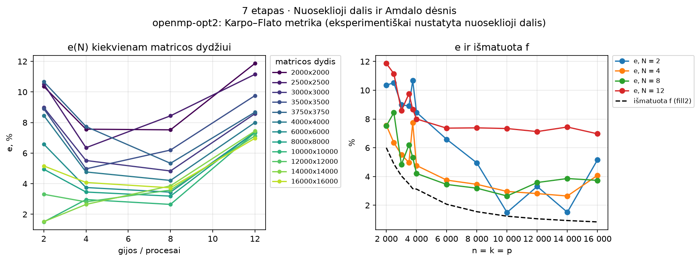
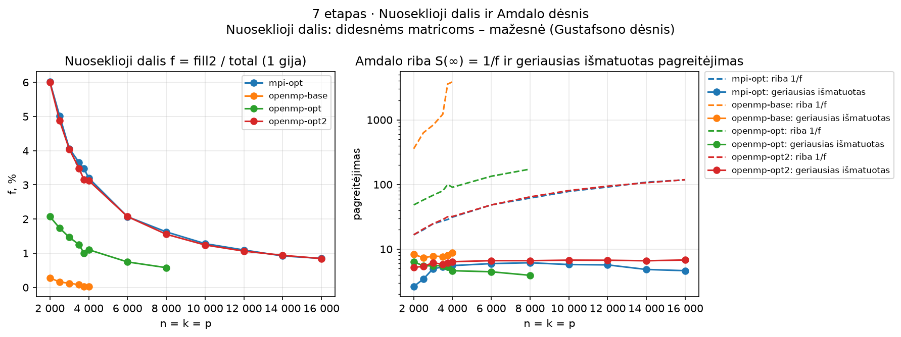

# 7 etapas · Nuoseklioji dalis ir Amdalo dėsnis

Duomenys: visi paleidimai – fill2 skirstiniui; `openmp-base` (n ≤ 4000),
`openmp-opt` (n ≤ 8000), `openmp-opt2`, `mpi-opt` – Amdalo grafikams.
Teorija, E branduolių matavimas ir pilnos lentelės:
[`docs/amdahl.md`](../../docs/amdahl.md).

Pagal užduotį matrica B pildoma **nuosekliai**. Tai Amdalo dėsnio nuoseklioji dalis, ir
mes ją matuojame tiesiogiai: f = fill2 / total, imant paleidimą su 1 gija (procesu).
Amdalo dėsnis: S(N) = 1 / (f + (1 − f) / N), riba S(∞) = 1 / f.

## Pats nuoseklusis pildymas

| n     | paleidimai | mediana  | vidurkis    |
|-------|------|---------|---------|
| 2000  | 173  | 13,6 ms | 14,4 ms |
| 4000  | 173  | 53,6 ms | 55,1 ms |
| 8000  | 34   | 217 ms  | 222 ms  |
| 16000 | 19   | 866 ms  | 917 ms  |

Auga kaip n²; skirstinys asimetriškas į dešinę (keli uždelsti paleidimai), todėl visuose grafikuose naudojama mediana.

Pagal matricos B elementų skaičių k·p (= n²) pildymo laikas yra tiesė, einanti per 0:
apie 3,4 ns vienam elementui (vienas atsitiktinis skaičius). Daugyba auga kaip n³,
todėl nuoseklioji dalis f mažėja maždaug kaip 1/n.

## Fazės: fill2 nemažėja

Daugyba (mėlyna) trumpėja didėjant gijų skaičiui, nuoseklusis pildymas (raudona) išlieka.
Kai n = 2000, jis sudaro 31 % 8 gijų laiko; kai n = 16000, jo beveik nesimato.

## Teorija ir matavimai

Ištisinė linija: išmatuotas pagreitėjimas; punktyrinė: Amdalo dėsnis su to paties dydžio išmatuotu f.

- **Mažas n:** matavimas artimas kreivei (n = 2000, 8 gijos: 5,2× ir
  5,6×) – ribą paaiškina nuoseklusis pildymas.
- **Didelis n:** f < 1 %, dėsnis leidžia 7,5× su 8 gijomis, gauname 6,3×. Pagreitėjimą riboja
  kažkas kita.
- **12 gijų:** klasikinis dėsnis (vienodi branduoliai) prognozuoja iki 11×.

Su N_eff = min(N, 8) + 0,15 · max(N − 8, 0) – išmatuota, kad E branduolys atitinka 0,15
P branduolio (`taskpolicy -b`), – kreivės po 8 gijų tampa beveik plokščios, kaip ir
matavimai.

## Kas dar riboja pagreitėjimą: Karpo–Flato metrika

e = (1/S − 1/N) / (1 − 1/N) – tai nuoseklioji dalis, kuri paaiškintų išmatuotą
pagreitėjimą. Su 8 gijomis e ≈ 3–4 % visiems n ≥ 4000, o f nukrinta iki 0,84 %: apie 3 %
nuostolių, kurie nepriklauso nuo uždavinio dydžio (tikėtina, taktinis dažnis ir bendri podėliai /
atmintis, kai dirba visi P branduoliai, bei lygiagretaus ciklo „uodega“). Su 12 gijų
e ≈ 7 %: E branduoliai.

## Gustafsono dėsnis: didesni uždaviniai plečiasi geriau

f ≈ c / n, nes pildymas auga kaip n², o daugyba – kaip n³. Riba 1/f
išauga nuo 17 (n = 2000) iki 119 (n = 16000), todėl išmatuotas
`openmp-opt2` pagreitėjimas didėjant n auga – iki minėtos aparatinės ribos.

Kiti grafikai: toks pats rinkinys `openmp-base`, `openmp-opt` ir `mpi-opt`
(`<variant>-amdahl.png`, `-amdahl-hetero.png`, `-phases.png`, `-karpflatt.png`).
`openmp-opt` e gerokai viršija f (atminties magistralė, 4 etapas); `mpi-opt` praranda plečiamumą, kai
n ≥ 14000 (e iki 38 % su 12 procesų).
