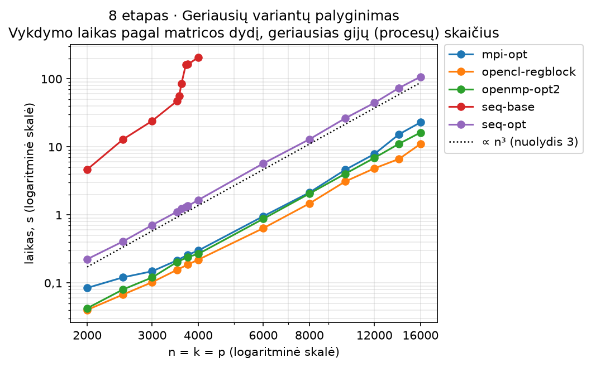

# 8 etapas · Galutinis geriausių variantų palyginimas

Duomenys: `seq-base` (atskaitos taškas), `seq-opt`, `openmp-opt2`, `mpi-opt`,
`opencl-opt` (kernelis `regblock`), geriausias gijų (procesų) skaičius, iki n = 16000.

Abi ašys logaritminės: laipsninė priklausomybė T ∝ nᵃ yra tiesė, kurios nuolydis a.
Taškinė linija – ∝ n³ (daugybos sudėtingumas) palyginimui.

`total` laikas:

| n     | seq-base | seq-opt (1 branduolys) | openmp-opt2 (8 gijos) | mpi-opt (8 proc.) | opencl regblock (GPU) |
|-------|----------|------------------|----------------------|-------------------|-----------------------|
| 4000  | 208 s    | 1,66 s           | 0,276 s              | 0,300 s           | 0,220 s               |
| 8000  | –        | 12,9 s           | 2,08 s               | 2,13 s            | 1,47 s                |
| 16000 | –        | 107 s            | 17,4 s               | 22,9 s            | 11,1 s                |

Išvados:

1. **Svarbiausia – atminties prieigos šablonas.** Tas pats vienas branduolys ties n = 4000 tapo 125×
   greitesnis (2–3 etapai) – daugiau, nei davė bet koks lygiagretinimas.
2. **CPU su tuo pačiu skaičiavimo branduoliu OpenMP ir MPI rezultatai artimi** (6–7× su 8 branduoliais).
   Esant dideliam n, OpenMP šiek tiek greitesnis: bendrai naudojama atmintis, nėra B kopijų ir C
   surinkimo, o dinaminis paskirstymas susidoroja su taupiaisiais branduoliais.
3. **GPU yra greičiausias** (kai n = 16000, apie 1,6× greitesnis nei 8 CPU branduoliai), bet
   tik po trijų optimizavimo žingsnių: naivus kernelis buvo 14× lėtesnis už
   `openmp-opt2`.
4. **Nuoseklusis B pildymas** išlieka visų greitųjų variantų riba (7 etapas).

`size-linear.png` rodo tuos pačius duomenis pagal operacijų skaičių n·k·p tiesinėmis ašimis:
greitųjų variantų taškai guli tiesėse, t. y. vienos operacijos kaina nepriklauso nuo n.
